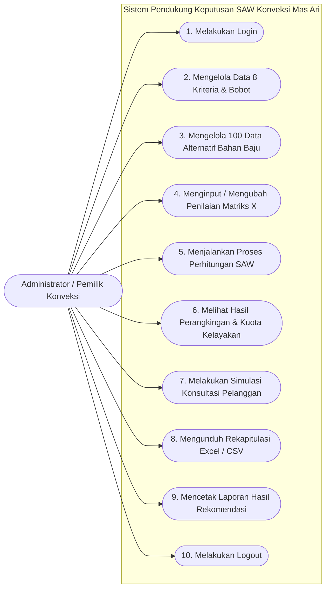
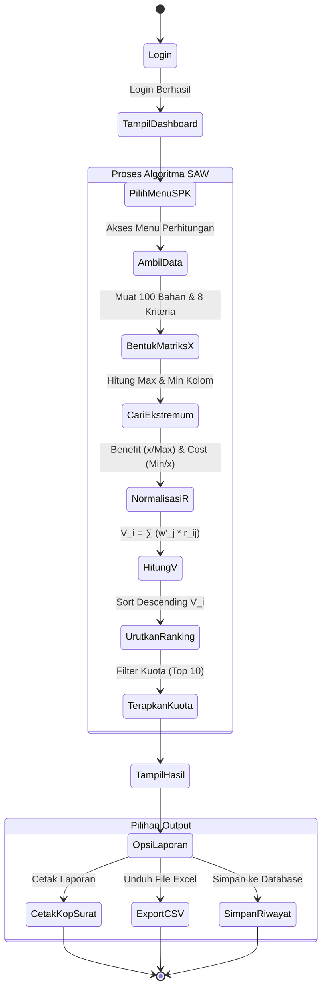
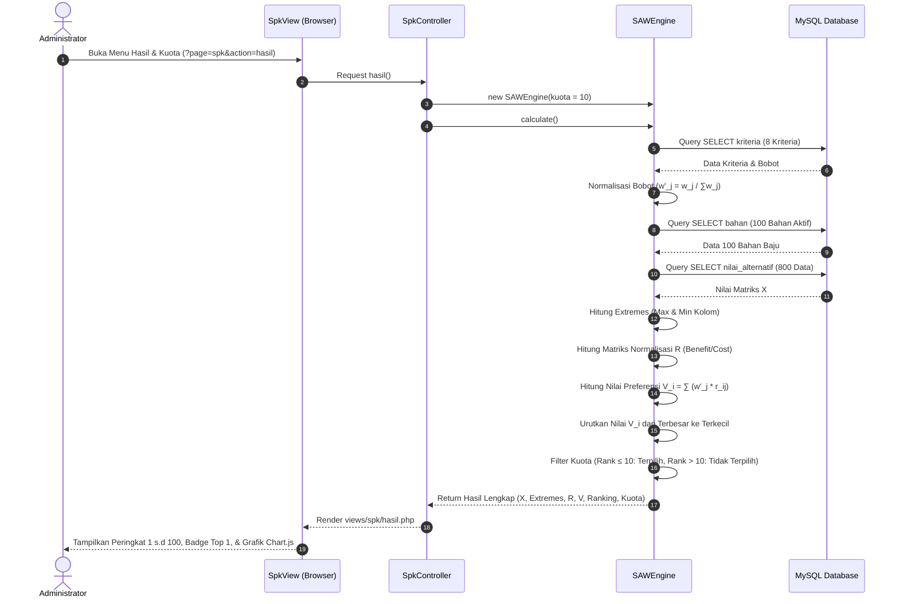
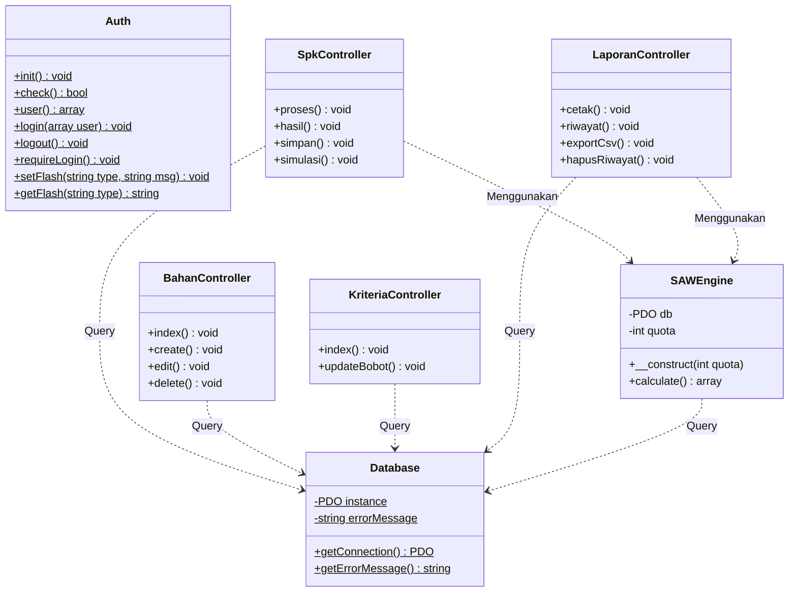
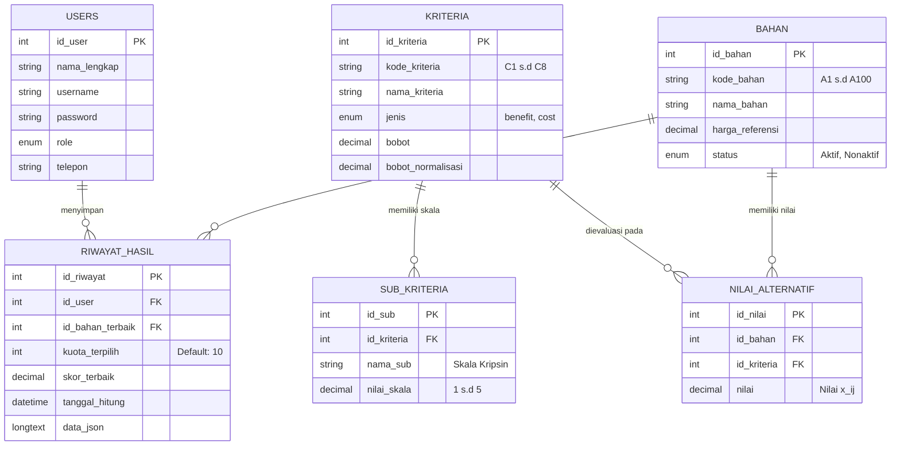

# DOKUMEN PERANCANGAN SISTEM (BAB III SKRIPSI)

## SISTEM PENDUKUNG KEPUTUSAN PENENTUAN BAHAN BAJU PADA KONVEKSI MAS ARI KOTA BEKASI MENGGUNAKAN METODE SIMPLE ADDITIVE WEIGHTING (SAW)

Dokumen ini disusun untuk melengkapi **Bab III (Perancangan Sistem)** pada Buku Laporan Tugas Akhir / Skripsi di Program Studi Teknik Informatika, Fakultas Teknik dan Ilmu Komputer, Universitas Indraprasta PGRI (UNINDRA).

---

### Informasi Tugas Akhir
- **Nama Penyusun**: Agung Adhyaksa
- **NPM**: 202243500428
- **Program Studi**: Teknik Informatika (UNINDRA, 2026)
- **Studi Kasus**: Konveksi Mas Ari, Jl. Gondangdia Baru No.26, Pondokgede, Kota Bekasi

---

## 1. Use Case Diagram

*Use Case Diagram* mendeskripsikan interaksi antara aktor (pengguna) dengan fungsionalitas yang disediakan oleh sistem pendukung keputusan penentuan bahan baju.

### 1.1 Diagram Use Case (Mermaid)

### 1.2 Deskripsi Aktor & Use Case
1. **Aktor**: Administrator / Pemilik Usaha (Mas Ari & Pengelola Konveksi).
2. **Deskripsi Kasus Penggunaan**:
   - **Login**: Memvalidasi kredensial pengguna menggunakan enkripsi kata sandi BCRYPT.
   - **Kelola Kriteria**: Mengatur 8 kriteria ($C_1 - C_8$), sifat atribut (*Benefit/Cost*), dan nilai bobot yang dinormalisasi otomatis menjadi $\sum w'_j = 1$.
   - **Kelola Bahan Baju**: Melakukan penambahan, perubahan, pencarian, dan penghapusan terhadap 100 alternatif bahan baku kain.
   - **Penilaian Matriks**: Menginput nilai kinerja setiap bahan kain terhadap 8 kriteria menggunakan skala kripsin 1 s.d 5.
   - **Proses Perhitungan SAW**: Menampilkan tahapan matematis secara transparan (Matriks $X$, Nilai Max/Min, Matriks $R$, dan Nilai $V$).
   - **Hasil & Kuota**: Menampilkan urutan ranking 1 s.d 100 serta memfilter kuota kebutuhan produksi (Top 10 berstatus *Terpilih/Layak*, sisanya *Tidak Terpilih*).
   - **Simulasi Konsultasi**: Menyesuaikan bobot kriteria secara fleksibel untuk konsultasi pesanan khusus konsumen.
   - **Cetak Laporan**: Mencetak lembar rekomendasi resmi ber-Kop Surat Konveksi Mas Ari lengkap dengan tanda tangan pengesahan.

---

## 2. Activity Diagram (Alur Perhitungan SAW)

*Activity Diagram* menggambarkan aliran aktivitas sistem dari awal input data hingga menghasilkan rekomendasi bahan baju terbaik.

---

## 3. Sequence Diagram (Proses Perhitungan & Perangkingan SAW)

*Sequence Diagram* menggambarkan interaksi antar objek dalam sistem berdasarkan urutan waktu.

---

## 4. Class Diagram

*Class Diagram* menggambarkan struktur berorientasi objek sistem, atribut, metode, serta keterhubungannya.

---

## 5. Entity Relationship Diagram (ERD Basis Data)

Struktur relasi tabel dalam basis data `db_spk_konveksi_masari`:

---

## 6. Ringkasan Bab III untuk Naskah Skripsi
Diagram-diagram UML di atas dapat disalin atau diekspor ke format gambar (.png) dan disisipkan langsung ke dalam **Bab III (Metodologi Penelitian dan Perancangan Sistem)** skripsi Anda untuk memenuhi standar penyusunan Tugas Akhir di Program Studi Teknik Informatika Universitas Indraprasta PGRI (UNINDRA).

