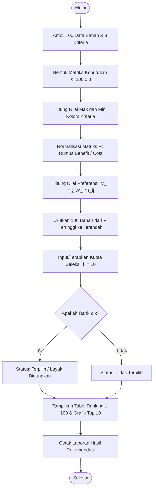

# PRODUCT REQUIREMENT DOCUMENT (PRD)

## SISTEM PENDUKUNG KEPUTUSAN PENENTUAN BAHAN BAJU PADA KONVEKSI MAS ARI KOTA BEKASI MENGGUNAKAN METODE SIMPLE ADDITIVE WEIGHTING (SAW)

---

### Informasi Dokumen & Tugas Akhir
- **Judul Tugas Akhir / Skripsi**: Sistem Pendukung Keputusan Penentuan Bahan Baju Pada Konveksi Mas Ari Kota Bekasi Menggunakan Metode Simple Additive Weighting (SAW)
- **Penyusun**: Agung Adhyaksa (NPM: 202243500428)
- **Institusi**: Program Studi Teknik Informatika, Fakultas Teknik dan Ilmu Komputer, Universitas Indraprasta PGRI (UNINDRA), 2026
- **Objek Penelitian**: Konveksi Mas Ari, Jl. Gondangdia Baru No.26, RT.004/RW.009, Kelurahan Jaticempaka, Kecamatan Pondokgede, Kota Bekasi, Jawa Barat
- **Jenis Sistem**: Sistem Pendukung Keputusan (SPK / DSS) Berbasis Web
- **Teknologi**: PHP (Backend & Frontend), MySQL (Database Relasional), Bootstrap 5 (Responsive UI), JavaScript / Chart.js
- **Jumlah Kriteria**: 8 Kriteria (7 Benefit, 1 Cost)
- **Jumlah Alternatif**: 100 Data Alternatif Bahan Baku Kain (A1 s.d A100)
- **Mekanisme Seleksi**: Perangkingan SAW + Kuota Kebutuhan Produksi (Bahan Terpilih / Layak Digunakan vs Tidak Terpilih)
- **Status Dokumen**: Final (Disesuaikan dengan Bab I, Bab II, dan Bab III Skripsi serta Dataset 100 Alternatif Resmi)

---

## 1. Pendahuluan & Latar Belakang Masalah

### 1.1 Latar Belakang
Industri konveksi di Indonesia mengalami pertumbuhan pesat seiring dengan tingginya permintaan produk pakaian custom untuk instansi, komunitas, maupun ritel. Dalam operasional konveksi, **bahan baku kain (bahan baju)** merupakan elemen paling fundamental yang menentukan kualitas, kenyamanan, durabilitas, serta kepuasan konsumen akhir.

Konveksi Mas Ari yang berlokasi di Pondokgede, Kota Bekasi melayani pesanan pakaian secara custom. Dalam menjalankan bisnisnya, Mas Ari selaku pemilik usaha mempunyai tantangan tersendiri dalam melakukan proses pemilihan bahan baju untuk pelanggannya, sehingga perlu dilakukan secara objektif, transparan, dan akuntabel. Namun demikian, penentuan bahan baju masih menghadapi kendala nyata:
1. **Proses Masih Manual**: Penentuan bahan baju dilakukan secara konvensional sehingga membutuhkan waktu yang lama dalam pengolahan data serta proses pemilihan, terutama ketika jumlah pelanggan meningkat.
2. **Subjektivitas Pengambilan Keputusan**: Pemilihan secara manual berpotensi menimbulkan ketidakkonsistenan dan subjektivitas.
3. **Banyaknya Jumlah Data Bahan Baju (100 Jenis Bahan Kain)**: Konveksi dihadapkan pada 100 ragam pilihan bahan baju (seperti Cotton Combed berbagai gramasi, Carded, Bambu, Drill, Spandex, Ripstop, Canvas, Fleece, Rayon, Parasut, Denim, hingga Tencel Organic). Analisis manual terhadap 100 pilihan tersebut sangat kompleks dan berisiko salah pilih.
4. **Integrasi Multi-Kriteria**: Belum tersedianya sistem yang mampu mengintegrasikan secara sistematis 8 kriteria penting (daya serap, keawetan, kelembutan, ketersediaan stok pasar, variasi warna, gramasi/ketebalan, kemudahan sablon/bordir, dan harga bahan).
5. **Kebutuhan Kuota Seleksi Bahan**: Konveksi membutuhkan mekanisme penetapan kuota kebutuhan produksi (misalnya menentukan 10 bahan baju terbaik yang layak diprioritaskan untuk stok/pengadaan).

Oleh karena itu, dibangun **Sistem Pendukung Keputusan (SPK) Penentuan Bahan Baju** berbasis web dengan menerapkan metode **Simple Additive Weighting (SAW)**.

### 1.2 Rumusan Masalah (Sesuai Bab I Skripsi)
1. Bagaimana proses pemilihan bahan baju pada Konveksi Mas Ari Kota Bekasi?
2. Bagaimana merancang Sistem Pendukung Keputusan (SPK) untuk membantu proses pengambil keputusan pemilihan bahan baju agar lebih objektif dan terstruktur?
3. Bagaimana mengolah data bahan baju dalam proses pemilihan bahan baju menggunakan sistem yang terkomputerisasi?
4. Bagaimana menentukan kriteria dalam proses pemilihan bahan baju pada Konveksi Mas Ari?
5. Bagaimana menerapkan metode *Simple Additive Weighting* (SAW) pada Sistem Pendukung Keputusan berbasis web untuk proses pemilihan bahan baju?

### 1.3 Batasan Masalah (Sesuai Bab I Skripsi)
1. Penelitian berfokus pada proses pemilihan bahan baju pada Konveksi Mas Ari Kota Bekasi.
2. Sistem yang dibangun digunakan untuk membantu proses pengambilan keputusan dalam menentukan bahan baju agar lebih objektif dan terstruktur.
3. Pengolahan data pada sistem dibatasi pada data bahan baju yang digunakan dalam proses pemilihan bahan baju (100 alternatif bahan baju).
4. Kriteria penilaian yang digunakan meliputi 8 kriteria yang telah ditentukan oleh pihak konveksi.
5. Sistem yang dikembangkan berupa Sistem Pendukung Keputusan berbasis web menggunakan metode Simple Additive Weighting (SAW).
6. Rekomendasi akhir disaring berdasarkan kuota kebutuhan produksi bahan (misal peringkat 1 sampai 10 dinyatakan terpilih/layak digunakan, sedangkan di luar kuota dinyatakan tidak terpilih).

---

## 2. Metodologi Algoritma Simple Additive Weighting (SAW)

Metode SAW (penjumlahan terbobot) mencari penjumlahan terbobot dari rating kinerja pada setiap alternatif di semua kriteria.

### 2.1 Delapan (8) Kriteria Penilaian Bahan Baju
Berdasarkan dokumen penelitian resmi pada Konveksi Mas Ari, terdapat 8 kriteria yang terdiri dari 7 kriteria **Benefit** dan 1 kriteria **Cost**:

| Kode | Nama Kriteria | Tipe / Sifat | Bobot Awal ($w_j$) | Normalisasi ($w'_j$) | Deskripsi & Tolok Ukur |
| :---: | :--- | :---: | :---: | :---: | :--- |
| **C1** | Daya Serap Bahan | **Benefit** | 15.00 | 0.1500 (15%) | Kemampuan serat menyerap keringat & sirkulasi udara (adhem). Semakin tinggi semakin baik. |
| **C2** | Keawetan Bahan | **Benefit** | 15.00 | 0.1500 (15%) | Ketahanan serat terhadap pencucian berulang, tidak mudah melar/berbulu. Semakin awet semakin baik. |
| **C3** | Kelembutan Bahan | **Benefit** | 15.00 | 0.1500 (15%) | Kehalusan tekstur saat bersentuhan dengan kulit (handfeel). Semakin halus semakin baik. |
| **C4** | Ketersedian Stok Pasar | **Benefit** | 10.00 | 0.1000 (10%) | Kemudahan supplier dalam menyediakan stok bahan secara rutin di Bekasi & Jakarta. |
| **C5** | Variasi Warna | **Benefit** | 10.00 | 0.1000 (10%) | Kelengkapan katalog pilihan warna kain yang tersedia di pasar. |
| **C6** | Gramasi / Tingkat Ketebalan Bahan | **Benefit** | 10.00 | 0.1000 (10%) | Ketebalan bahan yang proporsional (tidak menerawang dan tidak terlalu berat). |
| **C7** | Kemudahan dalam Sablon/Bordir | **Benefit** | 10.00 | 0.1000 (10%) | Kemudahan permukaan kain menerima sablon (plastisol/DTF) maupun jahitan bordir komputer. |
| **C8** | Harga Bahan | **Cost** | 15.00 | 0.1500 (15%) | Biaya pembelian bahan per satuan (Makin murah biaya, makin efisien biaya konveksi). |
| **Total** | | | **100.00** | **1.0000 (100%)** | |

### 2.2 Skala Penilaian Sub-Kriteria (Kripsin 1 - 5)
Untuk menjaga konsistensi penginputan data 100 alternatif bahan baju:

1. **C1 - Daya Serap Bahan (Benefit)**:
   - 1 = Sangat Rendah (Gerah, Kurang Menyerap)
   - 2 = Rendah (Cukup Gerah)
   - 3 = Cukup Baik (Menyerap Sedang)
   - 4 = Baik (Menyerap Baik)
   - 5 = Sangat Baik (Sangat Dingin & Cepat Menyerap)

2. **C2 - Keawetan Bahan (Benefit)**:
   - 1 = Sangat Rentan / Mudah Melar & Rusak
   - 2 = Kurang Awet
   - 3 = Cukup Awet
   - 4 = Awet & Tahan Lama
   - 5 = Sangat Awet, Tidak Berbulu & Kuat

3. **C3 - Kelembutan Bahan (Benefit)**:
   - 1 = Sangat Kasar / Kaku
   - 2 = Agak Kasar
   - 3 = Cukup Halus
   - 4 = Halus & Lembut
   - 5 = Sangat Halus & Lembut Premium

4. **C4 - Ketersedian Stok Pasar (Benefit)**:
   - 1 = Sangat Langka (Pre-Order Lama)
   - 2 = Jarang Tersedia
   - 3 = Cukup Tersedia
   - 4 = Mudahkan Ditemukan di Supplier
   - 5 = Sangat Melimpah & Selalu Ready Stock

5. **C5 - Variasi Warna (Benefit)**:
   - 1 = Sangat Sedikit (1 - 3 Warna Saja)
   - 2 = Pilihan Terbatas (4 - 7 Warna)
   - 3 = Cukup Banyak (8 - 15 Warna)
   - 4 = Banyak Varian (16 - 25 Warna)
   - 5 = Sangat Lengkap (> 25 Warna)

6. **C6 - Gramasi / Tingkat Ketebalan Bahan (Benefit)**:
   - 1 = Sangat Tipis / Menerawang
   - 2 = Agak Tipis
   - 3 = Ketebalan Sedang / Pas
   - 4 = Tebal & Mantap
   - 5 = Sangat Tebal & Kokoh

7. **C7 - Kemudahan dalam Sablon/Bordir (Benefit)**:
   - 1 = Sangat Sulit (Tinta Mudah Luntur/Serat Rusak)
   - 2 = Cukup Sulit Disablon/Bordir
   - 3 = Cukup Mudah
   - 4 = Mudah Disablon & Dibordir
   - 5 = Sangat Mudah, Hasil Sablon/Bordir Sangat Presisi

8. **C8 - Harga Bahan (Cost)**:
   - 1 = Sangat Mahal (> Rp 125.000 / kg atau yard)
   - 2 = Mahal (Rp 100.001 - Rp 125.000)
   - 3 = Sedang (Rp 75.001 - Rp 100.000)
   - 4 = Murah (Rp 50.001 - Rp 75.000)
   - 5 = Sangat Murah (<= Rp 50.000)

---

### 2.3 Formulasi Langkah Matematis SAW

#### 1. Normalisasi Bobot Kriteria ($w'_j$)
$$w'_j = \frac{w_j}{\sum_{j=1}^{n} w_j} \quad \text{dengan } n = 8$$

#### 2. Pembentukan Matriks Keputusan ($X$)
Matriks berukuran $100 \times 8$:
$$X = \begin{pmatrix} 
x_{1,1} & x_{1,2} & \dots & x_{1,8} \\ 
x_{2,1} & x_{2,2} & \dots & x_{2,8} \\ 
\vdots & \vdots & \ddots & \vdots \\ 
x_{100,1} & x_{100,2} & \dots & x_{100,8} 
\end{pmatrix}$$

#### 3. Normalisasi Matriks Keputusan ($R$)
- **Kriteria Benefit ($C_1, C_2, C_3, C_4, C_5, C_6, C_7$)**:
  $$r_{ij} = \frac{x_{ij}}{\max_i(x_{ij})}$$
- **Kriteria Cost ($C_8$)**:
  $$r_{ij} = \frac{\min_i(x_{ij})}{x_{ij}}$$

#### 4. Perhitungan Nilai Preferensi ($V_i$)
$$V_i = \sum_{j=1}^{8} w'_j \cdot r_{ij}$$

#### 5. Perangkingan dan Seleksi Kuota Kebutuhan
- Nilai $V_i$ diurutkan secara *descending* (dari yang terbesar ke yang terkecil).
- Peringkat 1 merupakan alternatif bahan baju terbaik.
- Seleksi kuota kebutuhan:
  - Jika peringkat $1 \le \text{Rank} \le \text{Kuota}$ (default: 10), maka status = **Terpilih (Layak Digunakan)**.
  - Jika peringkat $\text{Rank} > \text{Kuota}$, maka status = **Tidak Terpilih**.

---

## 3. Daftar 100 Data Alternatif Bahan Baju

Berikut adalah 100 jenis bahan baju (kain) yang menjadi alternatif pada Konveksi Mas Ari Kota Bekasi:

| Kode | Nama Bahan Baju | Karakteristik / Deskripsi Singkat | Estimasi Harga Acuan |
| :---: | :--- | :--- | :---: |
| **A1** | Cotton Combed 30s | Bahan katun murni 30s, standar kaos distro, sangat adem dan nyaman. | Rp 110,000 |
| **A2** | Cotton Combed 24s | Katun murni 24s, ketebalan sedang, sangat kuat dan tidak menerawang. | Rp 115,000 |
| **A3** | Cotton Combed 20s | Katun murni 20s gramasi tebal, mantap dan tahan lama. | Rp 120,000 |
| **A4** | Cotton Carded 30s | Katun berserat alami ekonomis, menyerap keringat dengan baik. | Rp 85,000 |
| **A5** | Cotton Carded 24s | Katun berserat alami ekonomis, menyerap keringat dengan baik. | Rp 85,000 |
| **A6** | Cotton Bamboo 30s | Bahan serat selulosa premium ramah lingkungan, sangat lembut dan daya serap tinggi. | Rp 135,000 |
| **A7** | Cotton Modal 30s | Bahan serat selulosa premium ramah lingkungan, sangat lembut dan daya serap tinggi. | Rp 135,000 |
| **A8** | CVC 30s | Campuran katun dan polyester dengan kenyamanan seimbang dan tahan susut. | Rp 85,000 |
| **A9** | CVC 24s | Campuran katun dan polyester dengan kenyamanan seimbang dan tahan susut. | Rp 85,000 |
| **A10** | TC 30s | Kain ekonomis berbasis serat polyester tahan kusut, ideal untuk produksi massal. | Rp 45,000 |
| **A11** | TC 24s | Kain ekonomis berbasis serat polyester tahan kusut, ideal untuk produksi massal. | Rp 45,000 |
| **A12** | Polyester (PE) Soft | Kain ekonomis berbasis serat polyester tahan kusut, ideal untuk produksi massal. | Rp 45,000 |
| **A13** | PE Single Knit | Kain ekonomis berbasis serat polyester tahan kusut, ideal untuk produksi massal. | Rp 45,000 |
| **A14** | PE Double Knit | Kain ekonomis berbasis serat polyester tahan kusut, ideal untuk produksi massal. | Rp 45,000 |
| **A15** | Dryfit Nike (Jarum) | Kain sintetis berpori mikro (quick dry), sangat baik untuk disublim/sablon. | Rp 62,000 |
| **A16** | Dryfit Milano | Kain sintetis berpori mikro (quick dry), sangat baik untuk disublim/sablon. | Rp 62,000 |
| **A17** | Dryfit Bintik (Pique) | Kain sintetis berpori mikro (quick dry), sangat baik untuk disublim/sablon. | Rp 62,000 |
| **A18** | Dryfit Wave | Kain sintetis berpori mikro (quick dry), sangat baik untuk disublim/sablon. | Rp 62,000 |
| **A19** | Dryfit Sulur | Kain sintetis berpori mikro (quick dry), sangat baik untuk disublim/sablon. | Rp 62,000 |
| **A20** | Lacoste Cotton Pique | Bahan berpori khas polo shirt, tampil formal dan berkelas. | Rp 120,000 |
| **A21** | Lacoste CVC | Bahan berpori khas polo shirt, tampil formal dan berkelas. | Rp 120,000 |
| **A22** | Lacoste PE | Bahan berpori khas polo shirt, tampil formal dan berkelas. | Rp 120,000 |
| **A23** | Baby Terry Cotton | Kain rajutan hangat bertekstur lembut untuk jaket, hoodie, dan sweater. | Rp 105,000 |
| **A24** | Baby Terry PE | Kain rajutan hangat bertekstur lembut untuk jaket, hoodie, dan sweater. | Rp 105,000 |
| **A25** | Fleece Cotton | Kain rajutan hangat bertekstur lembut untuk jaket, hoodie, dan sweater. | Rp 105,000 |
| **A26** | Fleece PE | Kain rajutan hangat bertekstur lembut untuk jaket, hoodie, dan sweater. | Rp 105,000 |
| **A27** | Fleece CVC | Kain rajutan hangat bertekstur lembut untuk jaket, hoodie, dan sweater. | Rp 105,000 |
| **A28** | Katun Toyobo Fodu | Kain katun woven berkualitas untuk kemeja formal dan kasual. | Rp 82,000 |
| **A29** | Katun Japan Design | Kain katun woven berkualitas untuk kemeja formal dan kasual. | Rp 82,000 |
| **A30** | Katun Rayon | Kain adem, tekstur halus jatuh di badan, nyaman untuk pakaian santai. | Rp 72,000 |
| **A31** | Katun Poplin | Kain katun woven berkualitas untuk kemeja formal dan kasual. | Rp 82,000 |
| **A32** | Katun Linen Euro | Kain katun woven berkualitas untuk kemeja formal dan kasual. | Rp 82,000 |
| **A33** | Linen Slub | Kain tekstil pilihan untuk kebutuhan produksi konveksi. | Rp 75,000 |
| **A34** | Katun Oxford | Kain katun woven berkualitas untuk kemeja formal dan kasual. | Rp 82,000 |
| **A35** | Katun Twill | Kain katun woven berkualitas untuk kemeja formal dan kasual. | Rp 82,000 |
| **A36** | Katun Madinah | Kain katun woven berkualitas untuk kemeja formal dan kasual. | Rp 82,000 |
| **A37** | Katun Cigarette | Kain katun woven berkualitas untuk kemeja formal dan kasual. | Rp 82,000 |
| **A38** | Katun Ima | Kain katun woven berkualitas untuk kemeja formal dan kasual. | Rp 82,000 |
| **A39** | American Drill 1988 | Kain tenun drill berpola diagonal, sangat kokoh untuk kemeja seragam/bordir. | Rp 85,000 |
| **A40** | Japan Drill | Kain tenun drill berpola diagonal, sangat kokoh untuk kemeja seragam/bordir. | Rp 85,000 |
| **A41** | Taipan Drill | Kain tenun drill berpola diagonal, sangat kokoh untuk kemeja seragam/bordir. | Rp 85,000 |
| **A42** | Hisofy Drill | Kain tenun drill berpola diagonal, sangat kokoh untuk kemeja seragam/bordir. | Rp 85,000 |
| **A43** | Nagata Drill | Kain tenun drill berpola diagonal, sangat kokoh untuk kemeja seragam/bordir. | Rp 85,000 |
| **A44** | Unione Drill | Kain tenun drill berpola diagonal, sangat kokoh untuk kemeja seragam/bordir. | Rp 85,000 |
| **A45** | Castillo Drill | Kain tenun drill berpola diagonal, sangat kokoh untuk kemeja seragam/bordir. | Rp 85,000 |
| **A46** | Verlando Drill | Kain tenun drill berpola diagonal, sangat kokoh untuk kemeja seragam/bordir. | Rp 85,000 |
| **A47** | Ripstop Tornado | Kain windbreaker/water resistant tahan gesekan untuk jaket outdoor. | Rp 65,000 |
| **A48** | Ripstop PE | Kain windbreaker/water resistant tahan gesekan untuk jaket outdoor. | Rp 65,000 |
| **A49** | Ripstop Nylon | Kain windbreaker/water resistant tahan gesekan untuk jaket outdoor. | Rp 65,000 |
| **A50** | Canvas Marsoto | Kain tebal bertekstur kuat dan berdaya tahan tinggi. | Rp 95,000 |
| **A51** | Canvas Ring | Kain tebal bertekstur kuat dan berdaya tahan tinggi. | Rp 95,000 |
| **A52** | Canvas Sueding | Kain tebal bertekstur kuat dan berdaya tahan tinggi. | Rp 95,000 |
| **A53** | Canvas Baby | Kain tebal bertekstur kuat dan berdaya tahan tinggi. | Rp 95,000 |
| **A54** | Canvas Terpal | Kain tebal bertekstur kuat dan berdaya tahan tinggi. | Rp 95,000 |
| **A55** | High Twist Intercooler | Kain tekstil pilihan untuk kebutuhan produksi konveksi. | Rp 75,000 |
| **A56** | High Twist Alexandro | Kain tekstil pilihan untuk kebutuhan produksi konveksi. | Rp 75,000 |
| **A57** | High Twist Millenium | Kain tekstil pilihan untuk kebutuhan produksi konveksi. | Rp 75,000 |
| **A58** | Soft Denim 10oz | Kain tebal bertekstur kuat dan berdaya tahan tinggi. | Rp 95,000 |
| **A59** | Rigid Denim 12oz | Kain tebal bertekstur kuat dan berdaya tahan tinggi. | Rp 95,000 |
| **A60** | Chambray Light | Kain tekstil pilihan untuk kebutuhan produksi konveksi. | Rp 75,000 |
| **A61** | Chiffon Ceruti | Kain tipis transparan berkarakter ringan untuk aksen dan variasi pakaian. | Rp 45,000 |
| **A62** | Chiffon Hycon | Kain tipis transparan berkarakter ringan untuk aksen dan variasi pakaian. | Rp 45,000 |
| **A63** | Wolfis Premium | Kain tekstil pilihan untuk kebutuhan produksi konveksi. | Rp 75,000 |
| **A64** | Wolfis Standard | Kain tekstil pilihan untuk kebutuhan produksi konveksi. | Rp 75,000 |
| **A65** | Satin Velvet | Kain berpenampilan kilau mewah, licin, dan jatuh elegan. | Rp 100,000 |
| **A66** | Satin Roberto Cavalli | Kain berpenampilan kilau mewah, licin, dan jatuh elegan. | Rp 100,000 |
| **A67** | Satin Silk Armani | Kain berpenampilan kilau mewah, licin, dan jatuh elegan. | Rp 100,000 |
| **A68** | Maxmara Luxury | Kain berpenampilan kilau mewah, licin, dan jatuh elegan. | Rp 100,000 |
| **A69** | Organza Crystal | Kain tipis transparan berkarakter ringan untuk aksen dan variasi pakaian. | Rp 45,000 |
| **A70** | Tile Polos | Kain tipis transparan berkarakter ringan untuk aksen dan variasi pakaian. | Rp 45,000 |
| **A71** | Tile Mutiara | Kain tipis transparan berkarakter ringan untuk aksen dan variasi pakaian. | Rp 45,000 |
| **A72** | Spandex Jersey Premium | Kain elastis fleksibel, mengikuti bentuk tubuh, kuat dan tidak mudah berkerut. | Rp 85,000 |
| **A73** | Spandex Rayon | Kain adem, tekstur halus jatuh di badan, nyaman untuk pakaian santai. | Rp 72,000 |
| **A74** | Spandex Balon | Kain elastis fleksibel, mengikuti bentuk tubuh, kuat dan tidak mudah berkerut. | Rp 85,000 |
| **A75** | Scuba Premium | Kain elastis fleksibel, mengikuti bentuk tubuh, kuat dan tidak mudah berkerut. | Rp 85,000 |
| **A76** | Scuba Standar | Kain elastis fleksibel, mengikuti bentuk tubuh, kuat dan tidak mudah berkerut. | Rp 85,000 |
| **A77** | Hyget Super | Kain ekonomis berbasis serat polyester tahan kusut, ideal untuk produksi massal. | Rp 45,000 |
| **A78** | Hyget Balon | Kain ekonomis berbasis serat polyester tahan kusut, ideal untuk produksi massal. | Rp 45,000 |
| **A79** | Hyget Serena | Kain ekonomis berbasis serat polyester tahan kusut, ideal untuk produksi massal. | Rp 45,000 |
| **A80** | Parasut Despo | Kain windbreaker/water resistant tahan gesekan untuk jaket outdoor. | Rp 65,000 |
| **A81** | Parasut Taslan JN | Kain windbreaker/water resistant tahan gesekan untuk jaket outdoor. | Rp 65,000 |
| **A82** | Parasut Milky | Kain windbreaker/water resistant tahan gesekan untuk jaket outdoor. | Rp 65,000 |
| **A83** | Parasut Metalik | Kain windbreaker/water resistant tahan gesekan untuk jaket outdoor. | Rp 65,000 |
| **A84** | Taslan Latex | Kain windbreaker/water resistant tahan gesekan untuk jaket outdoor. | Rp 65,000 |
| **A85** | Micro Fiber Premium | Kain windbreaker/water resistant tahan gesekan untuk jaket outdoor. | Rp 65,000 |
| **A86** | Micro NS | Kain windbreaker/water resistant tahan gesekan untuk jaket outdoor. | Rp 65,000 |
| **A87** | Corduroy Cotton | Kain tebal bertekstur kuat dan berdaya tahan tinggi. | Rp 95,000 |
| **A88** | Corduroy Polyester | Kain tebal bertekstur kuat dan berdaya tahan tinggi. | Rp 95,000 |
| **A89** | Suede Synthetic | Kain tekstil pilihan untuk kebutuhan produksi konveksi. | Rp 75,000 |
| **A90** | Velvet Premium | Kain tekstil pilihan untuk kebutuhan produksi konveksi. | Rp 75,000 |
| **A91** | Polyester PE 30s | Kain ekonomis berbasis serat polyester tahan kusut, ideal untuk produksi massal. | Rp 45,000 |
| **A92** | Semi Wool Tweed | Kain bermotif tenun berkarakter hangat dan nyaman. | Rp 115,000 |
| **A93** | Flannel Cotton Check | Kain bermotif tenun berkarakter hangat dan nyaman. | Rp 115,000 |
| **A94** | Flannel Wool | Kain bermotif tenun berkarakter hangat dan nyaman. | Rp 115,000 |
| **A95** | Rayon Viscose | Kain adem, tekstur halus jatuh di badan, nyaman untuk pakaian santai. | Rp 72,000 |
| **A96** | Crinkle Airflow | Kain adem, tekstur halus jatuh di badan, nyaman untuk pakaian santai. | Rp 72,000 |
| **A97** | Lady Zara | Kain adem, tekstur halus jatuh di badan, nyaman untuk pakaian santai. | Rp 72,000 |
| **A98** | Shakila Stretch | Kain adem, tekstur halus jatuh di badan, nyaman untuk pakaian santai. | Rp 72,000 |
| **A99** | Tencel Organic | Bahan serat selulosa premium ramah lingkungan, sangat lembut dan daya serap tinggi. | Rp 135,000 |
| **A100** | Bemberg Cupro | Bahan serat selulosa premium ramah lingkungan, sangat lembut dan daya serap tinggi. | Rp 135,000 |

---

## 4. Kebutuhan Fungsional Sistem (Functional Requirements)

Sesuai dengan rancangan pada Bab III Skripsi, sistem menyediakan 6 menu fungsional utama:

```
Fitur Utama Sistem SPK Penentuan Bahan Baju
 ├── 1. Data Bahan Baju (100 Alternatif)
 │    ├── Menampilkan daftar 100 alternatif bahan kain (pencarian & paginasi cepat)
 │    ├── Tambah data bahan kain baru
 │    ├── Edit / perbarui informasi nama, deskripsi, dan harga referensi bahan
 │    └── Hapus data bahan baju
 │
 ├── 2. Data Kriteria & Bobot (8 Kriteria)
 │    ├── Menampilkan 8 kriteria resmi (C1 s.d C8) beserta sifatnya (Benefit/Cost)
 │    ├── Form input/ubah bobot preferensi kriteria (w_j)
 │    ├── Perhitungan normalisasi bobot w'_j secara otomatis (∑ W = 1.00)
 │    └── Manajemen sub-kriteria kripsin (skala 1 s.d 5)
 │
 ├── 3. Penilaian Alternatif (Matriks X)
 │    ├── Antarmuka input nilai tiap alternatif bahan terhadap 8 kriteria
 │    ├── Fitur batch update nilai matriks untuk efisiensi pengisian 100 data
 │    └── Validasi otomatis kelengkapan seluruh 800 nilai matriks sebelum komputasi
 │
 ├── 4. Proses SAW (Perhitungan Terstruktur)
 │    ├── Tab 1: Matriks Keputusan Awal (X) berukuran 100 x 8
 │    ├── Tab 2: Pencarian Nilai Maksimum (Max) dan Minimum (Min) tiap kolom kriteria
 │    ├── Tab 3: Matriks Ternormalisasi (R) berdasarkan kaidah Benefit dan Cost
 │    └── Tab 4: Perkalian Matriks R dengan Bobot W hingga menghasilkan Nilai V_i
 │
 ├── 5. Hasil Seleksi & Perangkingan
 │    ├── Tabel ranking urutan 1 s.d 100 berdasarkan nilai preferensi V_i
 │    ├── Penanda khusus (badge emas) untuk Bahan Baju Peringkat 1 (Rekomendasi Utama)
 │    ├── Fitur Kuota Seleksi: Konveksi dapat menentukan jumlah kuota (default: 10 bahan)
 │    │    ├── Peringkat 1 - 10: Status "Terpilih (Layak Digunakan)"
 │    │    └── Peringkat > 10: Status "Tidak Terpilih"
 │    └── Visualisasi grafik batang skor Top 10 Bahan Terpilih (Chart.js)
 │
 └── 6. Laporan & Riwayat Keputusan
      ├── Cetak Laporan Hasil Seleksi Bahan Baju format resmi Konveksi Mas Ari
      ├── Ekspor rekapitulasi perangkingan ke Excel/CSV
      └── Simpan riwayat hasil perhitungan ke basis data
```

---

## 5. Kebutuhan Non-Fungsional (Non-Functional Requirements)

1. **Kapasitas & Efisiensi Algoritma**:
   - Sistem dioptimalkan untuk memproses komputasi matriks $100 \times 8$ (800 elemen) serta proses perankingan dan kuota dalam waktu kurang dari 0.3 detik.
2. **Validitas Matematis**:
   - Hasil normalisasi matriks $R$, nilai preferensi $V_i$, dan perankingan pada sistem diuji agar presisi identik dengan perhitungan manual Excel hingga 4-5 digit desimal.
3. **Keamanan (Security)**:
   - Enkripsi password menggunakan `password_hash` (`BCRYPT`).
   - Prepared Statements PDO di seluruh query database untuk pencegahan total dari **SQL Injection**.
   - Sanitasi output dengan `htmlspecialchars` untuk pencegahan **Cross-Site Scripting (XSS)**.
4. **Usability & Antarmuka**:
   - Desain responsif berbasis Bootstrap 5 yang nyaman diakses dari laptop, PC admin, maupun smartphone/tablet pemilik konveksi.
   - Paginasi dan fitur live search pada tabel 100 bahan baju agar navigasi tidak berat dan nyaman digunakan.

---

## 6. Perancangan Basis Data (Database Design)

- **Nama Database**: `db_spk_konveksi_masari`
- **Tabel-Tabel**:
  1. `users`: Menyimpan akun pengguna (Admin Agung Adhyaksa dan Pemilik Mas Ari).
  2. `kriteria`: Menyimpan 8 kriteria (C1-C8), sifat (benefit/cost), bobot ($w_j$), dan bobot normalisasi ($w'_j$).
  3. `sub_kriteria`: Skala kripsin nilai 1 s.d 5 untuk masing-masing kriteria.
  4. `bahan`: Menyimpan master 100 data alternatif bahan baju.
  5. `nilai_alternatif`: Menyimpan matriks keputusan $X$ (100 bahan $\times$ 8 kriteria = 800 nilai).
  6. `riwayat_hasil`: Menyimpan arsip riwayat perhitungan SAW, kuota terpilih, dan snapshot hasil perangkingan dalam format JSON.

---

## 7. Pemodelan UML & Alur Proses

### 7.1 Flowchart Perhitungan SAW dengan Kuota Kelayakan (100 Alternatif)



---

## 8. Jadwal & Roadmap Implementasi

| Minggu | Aktivitas / Milestone | Target Luaran |
| :---: | :--- | :--- |
| **1** | Analisis dokumen Bab I-III Skripsi & penetapan 8 kriteria serta 100 alternatif bahan | Dokumen PRD Final |
| **2** | Perancangan skema database MySQL & injeksi seeder 100 data bahan + 800 nilai matriks | File `.sql` siap import |
| **3** | Pembuatan Core Class `SAWEngine.php` & helper database PDO | Algoritma SAW teruji presisi |
| **4** | Pengembangan tampilan UI (Dashboard, Master Bahan, Master Kriteria, Matriks Nilai) | Antarmuka responsif |
| **5** | Implementasi Halaman Perhitungan Transparan, Perangkingan, Kuota, & Cetak Laporan | Modul SPK lengkap |
| **6** | Pengujian Black Box, verifikasi manual Excel vs Sistem, dan dokumentasi sidang | Sistem siap demonstrasi sidang TA |
